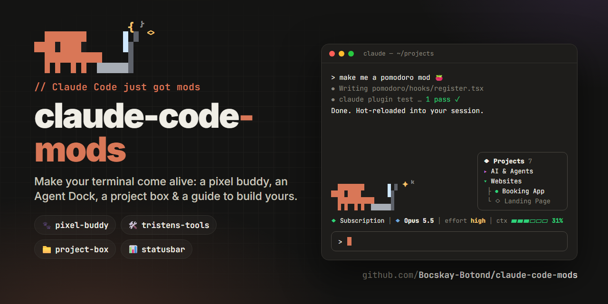

# 🧩 Claude Code Mods: Make Your Terminal Come Alive

Claude Code now has **mods**: plugins made of TypeScript function hooks that can draw UI right inside the terminal, react to everything Claude does, and change how it works. This repo contains four mods I use every day. There's a pixel critter that lives above your prompt, a control panel for model, effort and parallel agents, a project launcher box, and a live status bar. It also has everything you need to **build your own** in about 10 minutes.

[](https://claude.com/claude-code)
[](docs/writing-your-own-mod.md)
[](LICENSE)

> ⚠️ **Mods are early access.** The function-hooks API can change between Claude Code releases. Everything here was built and tested on **Claude Code 2.1.294**.

---

## ⚡ Quick Start (30 seconds)

Open Claude Code in a terminal and paste:

```
/plugin install pixel-buddy --marketplace Bocskay-Botond/claude-code-mods
```

Answer `y` to add the marketplace, press **Enter** for the user scope, and you're done. A little orange critter appears above your prompt. Start typing and watch it pull out a laptop. 🧡

Want the full setup? 👉 **[quick-start/](quick-start/README.md)**

---

## 🎮 What's Included

| Mod | What it does | Commands |
|---|---|---|
| 🐾 **[pixel-buddy](mods/pixel-buddy)** | A 12×4 pixel Claude critter above the prompt. It types on a tiny laptop while you type, patrols while Claude works, celebrates when a turn finishes, plays (keepy-uppy, jump rope, butterflies, bubbles, reading) when you're idle, and falls asleep after 3 minutes. | `/buddy` `/pet` |
| 🛠️ **[tristens-tools](mods/tristens-tools)** | A tools menu and status line: **model & effort picker**, **Clean View** (hides tool noise and shows a simple checklist), **Prompt Upgrade**, **Agent Dock** (split each request across 1–100 helper agents and watch them live), and a **Roadtrip** racing minigame. | `/tools` `/dock` `/roadtrip` |
| 📁 **[project-box](mods/project-box)** | A folder-tree card beside the status bar listing your projects by category. Click a category, then a project, to see its note and path. pixel-buddy walks over and "types the `cd`" for you. | `/projects` |
| 📊 **[statusbar](mods/statusbar)** | A minimal one-line status bar: working/idle, tool count, last tool, last turn duration, turns. The simplest real mod in the repo, so read this one first. | — |
| 👋 **[hello-mod](examples/hello-mod)** | The tutorial example: a slash command, a toast and a band in about 35 lines. | `/hello` |

Install any of them the same way:

```
/plugin install <mod-name> --marketplace Bocskay-Botond/claude-code-mods
```

---

## 📂 Repository Structure

```
claude-code-mods/
├── .claude-plugin/
│   └── marketplace.json      # makes this repo a plugin marketplace
├── mods/
│   ├── pixel-buddy/          # 🐾 the critter
│   ├── tristens-tools/       # 🛠️ tools menu, Agent Dock, Roadtrip
│   ├── project-box/          # 📁 project launcher card
│   └── statusbar/            # 📊 one-line status bar
├── examples/
│   └── hello-mod/            # 👋 your first mod, fully commented
├── quick-start/              # ⚡ 5-minute setup
├── docs/
│   ├── installation.md       # every way to install & manage mods
│   ├── writing-your-own-mod.md
│   ├── api-cheatsheet.md     # events, $ nouns, UI elements
│   └── troubleshooting.md
├── mod-builder-prompt/       # 🤖 a prompt that makes Claude build mods for you
```

Every mod is the same four small files:

```
my-mod/
├── .claude-plugin/plugin.json   # name, version, description
├── hooks/hooks.json             # { "modules": ["./register.tsx"] }
├── hooks/register.tsx           # the code
└── types/index.d.ts             # the state your mod keeps (optional)
```

---

## 🎯 What You'll Learn

- What a Claude Code **mod** is, and how it differs from skills, slash commands and classic shell hooks
- How the `on(event, hook)` / `next(e)` **middleware chain** works
- How to **draw UI** in the terminal: bands above the prompt, panes, buttons, even a pixel raster at 25 fps
- How to keep **state** with atoms and have the UI redraw automatically
- How to **change Claude's behaviour**: swap the model per request, add system-prompt sections, react to tool calls
- How to **test** a mod with `claude plugin test` and **ship** it as a GitHub marketplace

---

## 🚦 Prerequisites

- **Claude Code 2.1.294 or newer** in a terminal (`claude --version`)
- A Claude subscription or API key (whatever you already use with Claude Code)
- **Git** if you want to clone and hack on the mods
- Coffee ☕ (highly recommended)

No Node, no npm install, no build step. Claude Code compiles the TypeScript itself.

---

## 🔨 Build Your Own Mod

The fastest way is to ask Claude. Inside Claude Code:

```
Make me a mod that shows a 🍅 pomodoro timer above the prompt and plays a toast when it ends.
```

Claude Code has a built-in skill for this: it writes the mod, hot-reloads it into your session and tests it. For a better result, paste the prompt from **[mod-builder-prompt/](mod-builder-prompt/README.md)** first.

Prefer to do it by hand? **[docs/writing-your-own-mod.md](docs/writing-your-own-mod.md)** walks through [hello-mod](examples/hello-mod) line by line, and **[docs/api-cheatsheet.md](docs/api-cheatsheet.md)** has the events and elements you'll use most.

---

## 📁 Configure project-box

project-box shows a demo list until you give it yours. Copy the example and edit it:

```bash
# macOS / Linux
cp mods/project-box/project-box.example.json ~/.claude/project-box.json

# Windows (PowerShell)
Copy-Item mods\project-box\project-box.example.json $HOME\.claude\project-box.json
```

Restart Claude Code (or run `/reload-plugins`) and your projects show up. Colors can be any terminal color name (`magenta`, `cyan`, `green`, `yellow`, `blue`, `red`). Set `"live": true` for a green dot.

---

## 🐛 Troubleshooting

| Problem | Fix |
|---|---|
| Nothing appears after install | Run `/reload-plugins`, or restart Claude Code. Make sure you're in a **terminal**: `/plugin` isn't available in the desktop app's Code tab. |
| `Marketplace file not found` | Check the repo name: `Bocskay-Botond/claude-code-mods` |
| A mod silently does nothing | Start with `claude --debug`. A failing hook is skipped and logged with the reason. |
| Two bands fight for space | pixel-buddy, project-box and tristens-tools are designed to stack. Turn things off with `/buddy`, `/projects`, or `/plugin` → disable. |

More: **[docs/troubleshooting.md](docs/troubleshooting.md)**

---

## 🤝 Contributing

Built a cool mod? PRs are welcome!

1. Fork the repo
2. Add your mod under `mods/<your-mod>/` (four files, see above)
3. Make sure `claude plugin validate mods/<your-mod>` and `claude plugin test mods/<your-mod>` pass
4. Add it to `.claude-plugin/marketplace.json` and to the table in this README
5. Open a PR with a screenshot or GIF 📸

---

## 📄 License

[MIT](LICENSE). Do whatever you want, just don't blame me if your critter falls asleep on the job. 😴

---

## 🙏 Acknowledgments

- **[Tristen O'Brien](https://www.youtube.com/@Tristen_OBrien)**, whose video **["Claude Code Just Dropped MODS. (Master it in 10 Minutes)"](https://www.youtube.com/watch?v=LDn7rQKIFro)** inspired `tristens-tools` (Clean View, Agent Dock, Roadtrip and the tools menu). Go watch it!
- The Claude Code team at [Anthropic](https://www.anthropic.com) for shipping mods
- [NetworkChuck's docker-mcp-tutorial](https://github.com/theNetworkChuck/docker-mcp-tutorial) for the repo-as-tutorial format

---

## ☕ Support

If this made your terminal a little more fun, **⭐ star the repo** and share it with someone who lives in Claude Code.

Now go build a mod. Your terminal has been boring for long enough. 🚀
